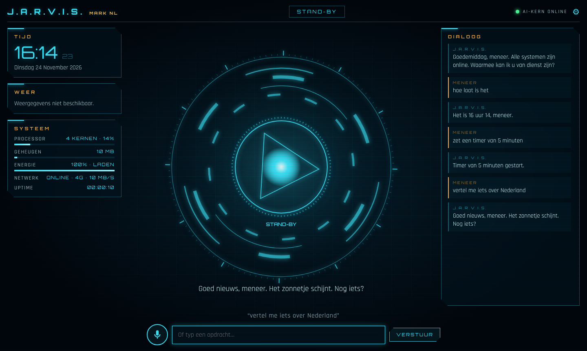

# J.A.R.V.I.S. — jouw Nederlandstalige AI-assistent



Een pratende assistent met een futuristische HUD-interface, in de stijl van een film-AI.
Jarvis luistert naar zijn naam, verstaat Nederlands, praat terug met een Nederlandse stem
en kan met Claude als "brein" over van alles een gesprek voeren en actuele informatie opzoeken.

## Wat kan hij?

- **Luistert naar "Jarvis"**: zeg bijvoorbeeld *"Jarvis, hoe laat is het?"* of eerst *"Jarvis"*, en dan je vraag.
- **Praat terug** in het Nederlands (met een stem die je zelf kunt kiezen).
- **Vrije gesprekken** via Claude: vragen, uitleg, ideeën, en actuele zaken zoals nieuws en sport (met webzoeken).
- **Ingebouwde opdrachten** (werken ook zonder AI-sleutel):
  - *"Hoe laat is het?"*, *"Welke dag is het?"*
  - *"Wat is het weer?"*
  - *"Zet een timer van 5 minuten"*, *"Annuleer de timers"*
  - *"Open YouTube"*, *"Open nu.nl"*, *"Speel Doe Maar af op YouTube"*, *"Google naar pannenkoekenrecept"*
  - *"Wis je geheugen"*, *"Stop"*, *"Stop met luisteren"* / *"Luister weer"*
- **HUD-interface**: animerende "reactor" die reageert op je stem, klok, weer, systeemstatus en een gesprekslog.

## Installeren

1. Installeer [Node.js](https://nodejs.org) (versie 20 of nieuwer).
2. Download deze map en open een terminal erin.
3. Installeer de onderdelen:
   ```bash
   npm install
   ```
4. Maak een API-sleutel aan op <https://console.anthropic.com> (voor het slimme brein).
5. Kopieer `.env.example` naar `.env` en vul je sleutel in:
   ```
   ANTHROPIC_API_KEY=sk-ant-...
   JARVIS_USER_NAME=meneer
   JARVIS_PASSWORD=een-sterk-wachtwoord
   ```
   Met `JARVIS_USER_NAME` bepaal je hoe Jarvis jou aanspreekt (bijv. `Django` of `baas`).
6. Start Jarvis:
   ```bash
   npm start
   ```
7. Open **http://localhost:3000** in **Google Chrome** of **Microsoft Edge**, klik op
   **SYSTEEM ACTIVEREN** en sta het gebruik van de microfoon toe.

> Zonder API-sleutel start Jarvis in *basismodus*: de ingebouwde opdrachten werken dan wel,
> vrije gesprekken niet.

## Online zetten via GitHub Pages (gratis, aanrader)

Je krijgt dan het adres **https://djangostoutenburg.github.io/Jarvis/**, beveiligd met een wachtwoord.

**Eenmalig instellen:**

1. Ga op GitHub naar je repository → **Settings** → **Pages**.
   Kies bij **Source** voor **GitHub Actions**.
2. Ga naar het tabblad **Actions**, klik links op **GitHub Pages** en dan op **Run workflow**.
   Na 1 à 2 minuten staat de site online.
3. Open **https://djangostoutenburg.github.io/Jarvis/setup.html** en vul in:
   je naam, je API-sleutel en een wachtwoord (minstens 12 tekens).
   Dit gebeurt alleen in je eigen browser; er wordt niets verstuurd.
4. Volg stap 2 op die pagina: kopieer de tekst en plak die in `public/config.js` op GitHub
   (potloodje ✎ → plakken → **Commit changes**).
5. Wacht 1 à 2 minuten en open **https://djangostoutenburg.github.io/Jarvis/**.
   Log in met je wachtwoord. Klaar!

**Hoe veilig is dit?**
- Je API-sleutel staat **versleuteld** (AES-256) in de site. Alleen met jouw wachtwoord kan hij
  worden ontsleuteld; dat gebeurt in je browser. Het wachtwoord zelf staat nergens.
- Omdat de versleutelde sleutel openbaar is, is een **lang wachtwoord** belangrijk
  (bijv. vier losse woorden). Stel daarnaast in de Anthropic Console een **uitgavelimiet** in.
- Wachtwoord wijzigen of sleutel vervangen: doe stap 3 en 4 opnieuw.
- Uitloggen kan met de ⏻-knop rechtsboven.

## Online zetten met eigen server (Render)

Zo zet je Jarvis gratis online op [Render](https://render.com). Je krijgt dan een eigen
https-adres zoals `https://jarvis-xxxx.onrender.com`, beveiligd met een wachtwoord.

1. Maak een gratis account op <https://render.com> en log in met GitHub.
2. Klik op **New +** → **Blueprint**.
3. Kies de repository **Jarvis** (en, als dat gevraagd wordt, de branch met deze code).
   Render leest het bestand `render.yaml` en stelt alles zelf in.
4. Render vraagt om twee waarden:
   - `ANTHROPIC_API_KEY`: je API-sleutel
   - `JARVIS_PASSWORD`: het wachtwoord dat je wilt gebruiken om in te loggen
     (kies een sterk wachtwoord, minstens 12 tekens)
5. Klik op **Apply**. Na een paar minuten staat Jarvis online; de URL staat bovenaan in Render.

Open de URL in Chrome of Edge en log in. Je blijft 30 dagen ingelogd op dat apparaat;
uitloggen kan met de ⏻-knop rechtsboven.

**Goed om te weten**
- Het wachtwoord wijzigen doe je in Render onder **Environment** → `JARVIS_PASSWORD`.
  Daarna is iedereen automatisch uitgelogd.
- Na 5 foute pogingen wordt inloggen vanaf dat adres 15 minuten geblokkeerd.
- Het gratis abonnement van Render "slaapt" na 15 minuten zonder gebruik; het eerste
  bezoek daarna duurt ongeveer een halve minuut. Met een betaald abonnement (vanaf ca. $7 p/m)
  blijft hij altijd wakker.
- De microfoon werkt alleen via https, dus dat zit met Render goed. Je kunt het ook op je
  telefoon gebruiken (Chrome op Android werkt het best).

## Bediening

| Actie | Hoe |
|---|---|
| Iets vragen | Zeg **"Jarvis …"**, klik op de microfoon, of druk op de **spatiebalk** |
| Typen | Gebruik het tekstvak onderaan |
| Jarvis onderbreken | Klik op de microfoon, druk op **Esc** of zeg **"stop"** |
| Stem, snelheid, toonhoogte | Tandwiel ⚙ rechtsboven |

## Tips

- **Mooiere stem**: in Microsoft Edge zitten zeer natuurlijke Nederlandse stemmen
  (bijv. *Microsoft Maarten Online (Natural)*). Kies die via ⚙.
- **Websites openen met je stem**: de browser blokkeert soms pop-ups. Sta pop-ups toe voor
  `localhost`, of klik op de link die Jarvis dan in het logboek zet.
- **Weer**: gebruikt je locatie (als je toestemming geeft), anders Amsterdam.
- Spraakherkenning in Chrome/Edge gebruikt een internetverbinding.

## Kosten

De AI-kern gebruikt het model `claude-opus-5-5` via de Anthropic API; je betaalt per gebruik
op je eigen API-account. Jarvis is ingesteld op korte, gesproken antwoorden, dus een gesprek kost
doorgaans maar een fractie van een cent per vraag (webzoekopdrachten kosten iets extra).

## Bestanden

- `server.js` — kleine server: inloggen, praten met Claude, en je API-sleutel buiten de browser houden.
- `login.html` — het inlogscherm.
- `render.yaml` — instellingen voor online zetten op Render.
- `public/index.html`, `public/style.css` — de HUD-interface.
- `public/app.js` — spraakherkenning, spraak, opdrachten, weer, systeempanelen en de reactor-animatie.
